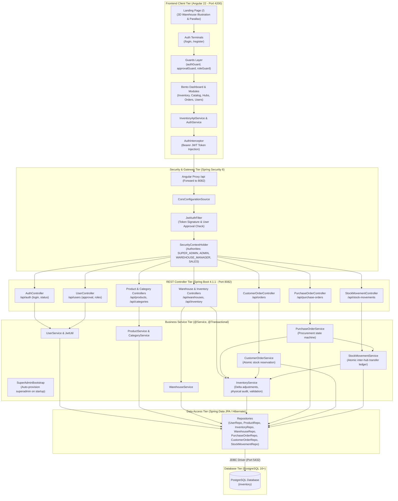
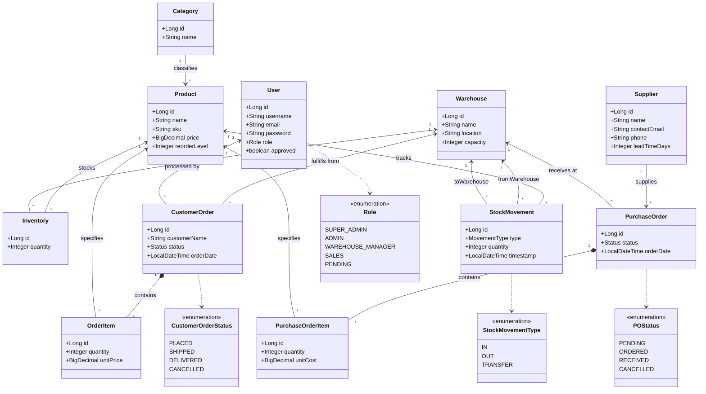
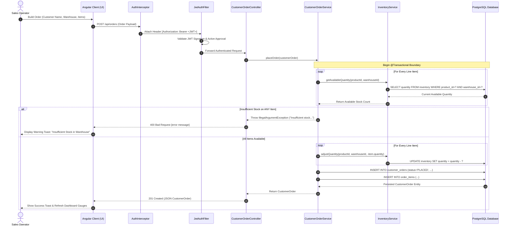
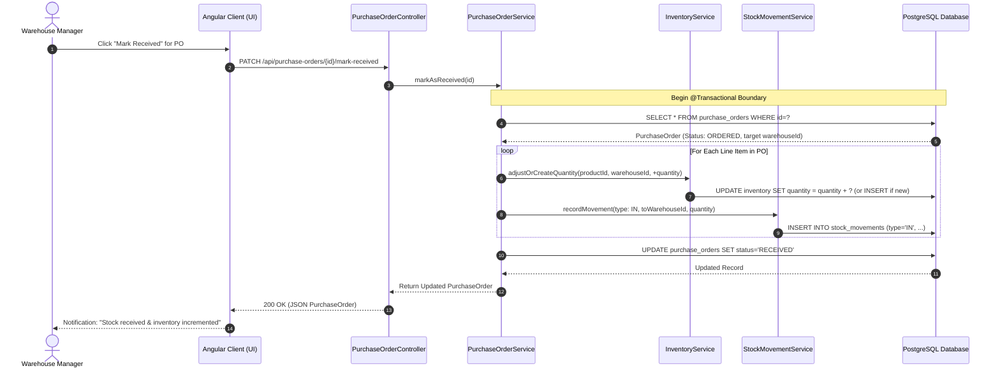
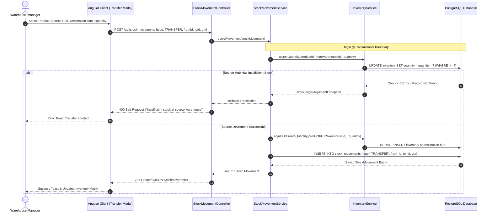
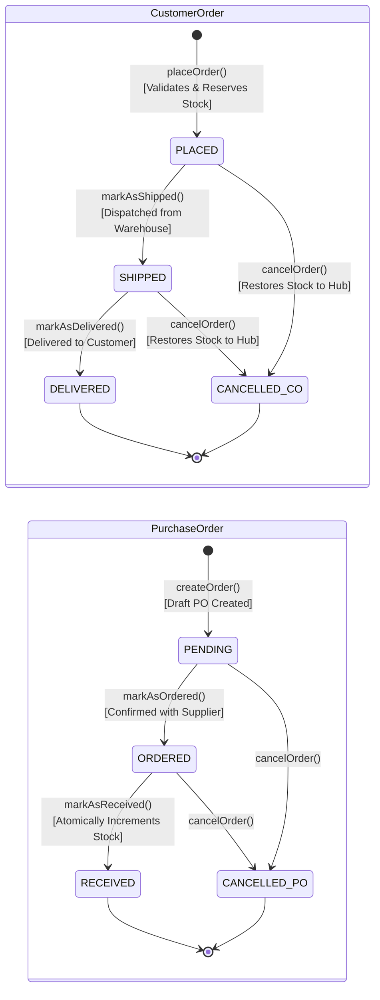
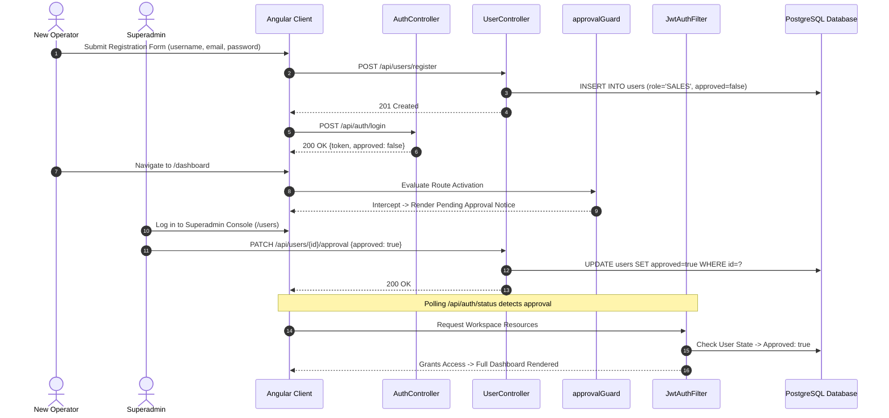

# Retail Inventory Management System (RIMS)

[](https://openjdk.org/)
[](https://spring.io/projects/spring-boot)
[](https://angular.dev/)
[](https://www.typescriptlang.org/)
[](https://www.postgresql.org/)
[](https://spring.io/projects/spring-security)
[](#)

An enterprise-grade, distributed **Retail Inventory Management System (RIMS)** built with a **Spring Boot 4 (Java 27)** REST API backend and an **Angular 22** client frontend. The platform delivers real-time multi-warehouse stock auditing, supplier procurement lifecycles, atomic customer order fulfillment with upfront stock reservation, inter-hub logistics transfers, and a multi-tenant role-based security framework with superadmin account approval (`SUPER_ADMIN`, `ADMIN`, `WAREHOUSE_MANAGER`, `SALES`, `UNAPPROVED`).

The frontend combines a high-performance **Alabaster Canvas & Enterprise Crimson** visual identity with **Geist** typography, an interactive **3D Warehouse Analytics** landing page with subtle pointer parallax and floating levitation, split-screen authentication terminals, and an executive **Bento-Grid** command dashboard with SVG telemetry gauges, sparklines, and facility monitors.

---

## Table of Contents

- [Visual Design & User Experience](#visual-design--user-experience)
  - [Design Tokens & Palette](#design-tokens--palette)
  - [Enterprise SaaS Landing Page](#enterprise-saas-landing-page)
  - [Split-Screen Authentication & Registration](#split-screen-authentication--registration)
  - [Executive Bento Command Dashboard](#executive-bento-command-dashboard)
- [Key Features](#key-features)
- [System Architecture](#system-architecture)
- [Repository Structure](#repository-structure)
- [Domain & Data Models](#domain--data-models)
  - [UML Class Diagram](#uml-class-diagram)
  - [Entity Schema Summary](#entity-schema-summary)
- [Business Workflows & Sequence Diagrams](#business-workflows--sequence-diagrams)
  - [1. Customer Sales Order & Stock Reservation](#1-customer-sales-order--stock-reservation-sequence)
  - [2. Supplier Procurement & Goods Receipt](#2-supplier-procurement--goods-receipt-sequence)
  - [3. Inter-Warehouse Stock Transfer](#3-inter-warehouse-stock-transfer-sequence)
  - [4. Order Lifecycle State Machines](#4-order-lifecycle-state-machines-statechart)
  - [5. Authentication, Registration & Superadmin Approval](#5-authentication-registration--superadmin-approval-flow)
- [Security, Roles & Account Governance](#security-roles--account-governance)
  - [Superadmin Bootstrap](#superadmin-bootstrap)
  - [Self-Service Registration & Quarantine](#self-service-registration--quarantine)
  - [Role-Based Access Control (RBAC) Matrix](#role-based-access-control-rbac-matrix)
- [REST API Reference](#rest-api-reference)
- [Prerequisites & Environment Configuration](#prerequisites--environment-configuration)
- [Running the Application](#running-the-application)
- [Validation & Automated Testing](#validation--automated-testing)
- [Frontend Components & Shared Architecture](#frontend-components--shared-architecture)

---

## Visual Design & User Experience

The application is engineered around an enterprise design system defined in [`frontend/src/styles.css`](frontend/src/styles.css):

### Design Tokens & Palette

| Token Role | Light Mode Swatch | Dark Mode Swatch | Purpose in Application |
|---|---|---|---|
| **Canvas Background** | `#EFEDE6` (Alabaster) | `#131719` (Carbon) | Ambient warm page backdrop with high contrast ratio |
| **Card & Panel Surface** | `#FFFFFF` (Pure White) | `#1D2327` (Deep Slate) | Elevated surfaces, modal windows, table containers |
| **Primary Brand Accent** | `#CD0000` (Enterprise Red) | `#E53935` (Crimson) | Brand logos, primary CTA buttons, active state indicators |
| **Primary Text / Charcoal** | `#161E22` (Deep Charcoal) | `#F4F6F6` (Off-White) | High-contrast display headlines, metric readouts, body copy |
| **Secondary & Muted Text**| `#4A5568` / `#6C7A89` | `#94A3B8` / `#CBD5E1` | Metadata labels, breadcrumbs, column headers, timestamps |
| **Subtle Borders** | `#DFDCD3` | `#2C353B` | Clean card outlines, table row dividers, and input borders |

### Enterprise SaaS Landing Page

Located at `/` (and `/landing`), the public landing page introduces operators and stakeholders to the RIMS platform:
- **3D Warehouse Analytics Artwork:** Features a high-fidelity warehouse operator interacting with real-time HUD telemetry, conveyor belt with packaged goods, and an autonomous delivery drone (`frontend/public/hero-warehouse-analytics.png`).
- **Restrained Motion Design:**
  - Continuous 5-second vertical levitation (`translateY(-8px)`) with an elliptical ambient floor shadow.
  - Subtle pointer-responsive parallax bounded strictly to 4–6px of displacement (`translate3d`), returning smoothly to origin on cursor leave.
  - Parallax is automatically disabled on touch devices and respects `prefers-reduced-motion: reduce`.
- **Dynamic Dual-Pill CTA:** Intelligently switches between **"LAUNCH CONSOLE"** + **"CREATE ACCOUNT"** for guest visitors and **"GO TO DASHBOARD"** for authenticated operators.
- **Enterprise Status Indicators:** Compact security & compliance badges (SOC2 Type II, ISO 27001, 99.99% SLA) and responsive mobile navigation drawer.

### Split-Screen Authentication & Registration

- **Login Terminal (`/login`):** Split-screen layout pairing input forms with branded 3D logistics artwork (`auth-login-art.png`), one-click quick-fill demo operator profiles (`SUPER_ADMIN`, `ADMIN`, `WAREHOUSE_MANAGER`, `SALES`), and live error diagnostics.
- **Operator Registration (`/register`):** Dedicated registration terminal with 3D packaging artwork (`auth-register-art.png`), real-time form validation, password matching, and immediate auto-routing into an approval notice for unapproved accounts.

### Executive Bento Command Dashboard

Located at `/dashboard` for approved operators:
- **Slim Icon Dock Sidebar:** 76px minimalist navigation rail with active badge indicators, theme toggles, and user initials pill.
- **Facility Telemetry & Sparklines:** Live digital clock, facility temperature/humidity status (21°C), and SVG sparklines.
- **Order Velocity Ring Gauge:** Radial SVG gauge tracking daily dispatch velocity against active targets.
- **Operations Priority Checklist:** Interactive dispatch priority board with pending and completed badges.
- **Quick Action Hub:** Instant shortcuts to PO creation, customer sales orders, inter-hub stock transfers, and audits.

---

## Key Features

- **Multi-Warehouse Stock Auditing**: Real-time stock counts across multiple facilities with capacity utilization meters, reorder thresholds, exact physical overwrite audits, and incremental delta adjustments.
- **Atomic Customer Order Fulfillment**: Sales order processing with mandatory upfront stock reservation across all line items, atomic decrement, and automatic stock restoration upon cancellation.
- **Supplier Procurement Workflows**: Complete purchase order lifecycle (`PENDING` $\rightarrow$ `ORDERED` $\rightarrow$ `RECEIVED`) where receiving a shipment atomically increments inventory at the destination hub and logs an immutable audit entry.
- **Inter-Warehouse Stock Transfers**: Atomic logistics transfers between facilities ensuring simultaneous source decrement and destination increment within a single database transaction.
- **Superadmin Governance & User Approval**: Account quarantine where self-registered users remain unapproved until vetted by a Superadmin. Dynamic role promotion, profile editing, and account revocation.
- **Stateless JWT Security**: HMAC-SHA256 tokens with 24-hour expiration, BCrypt password hashing, and write-only password serialization preventing credential exposure.

---

## System Architecture

The application implements a decoupled, modern multi-tier architecture with an **Angular 22** client communicating via REST/JSON with a **Spring Boot 4.1.1** backend on **Java 27**, backed by a **PostgreSQL 16+** relational database:



---

## Repository Structure

```text
HCLTech-RIMS/
├── .github/
│   └── workflows/
│       └── ci.yml                         # Full-stack GitHub Actions CI pipeline
├── backend/                               # Spring Boot REST API Service (Port 8082)
│   ├── .mvn/                              # Maven Wrapper configuration
│   ├── src/
│   │   ├── main/
│   │   │   ├── java/com/hcl/inventory/
│   │   │   │   ├── config/                # SecurityConfig, SuperAdminBootstrap, PasswordConfig
│   │   │   │   ├── controller/            # 10 REST Controllers (Auth, Users, Products, Orders, etc.)
│   │   │   │   ├── dto/                   # Request/Response records (LoginRequest, ApprovalUpdate, etc.)
│   │   │   │   ├── exception/             # GlobalExceptionHandler (@RestControllerAdvice)
│   │   │   │   ├── model/                 # 11 JPA Domain Entities & Operational Enums
│   │   │   │   ├── repository/            # 10 Spring Data JPA Repositories
│   │   │   │   ├── security/              # JwtAuthFilter & JwtUtil
│   │   │   │   ├── service/               # Core business services (@Transactional)
│   │   │   │   └── InventoryApplication.java
│   │   │   └── resources/
│   │   │       ├── application.yaml       # Core application configuration
│   │   │       └── application-local.yaml # Local development overrides
│   │   └── test/                          # Unit and integration test suites
│   ├── mvnw / mvnw.cmd                    # Maven wrapper executables
│   └── pom.xml                            # Maven POM (Java 27, Spring Boot 4.1.1, Lombok)
├── frontend/                              # Angular 22 Single Page Application (Port 4200)
│   ├── public/                            # Static assets and high-fidelity graphics
│   │   ├── fonts/geist/                   # Self-hosted Geist Variable font files
│   │   ├── auth-login-art.png             # Split-screen 3D login artwork
│   │   ├── auth-register-art.png          # Split-screen 3D registration artwork
│   │   ├── hero-warehouse-analytics.png   # 3D Warehouse Analytics operator & drone illustration
│   │   └── rims-mark.svg                  # SVG brand emblem
│   ├── src/
│   │   ├── app/
│   │   │   ├── components/                # Application View Components
│   │   │   │   ├── landing/               # Enterprise SaaS landing page with parallax & levitation
│   │   │   │   ├── login/                 # Split-screen login with demo credentials
│   │   │   │   ├── register/              # Split-screen registration with validation
│   │   │   │   ├── dashboard/             # 10-card Bento dashboard with SVG gauges & charts
│   │   │   │   ├── inventory/             # Stock matrix, delta adjustments, and audit overrides
│   │   │   │   ├── products/              # Product catalog and category taxonomy
│   │   │   │   ├── warehouses/            # Warehouse telemetry, capacity bars, and manifests
│   │   │   │   ├── purchase-orders/       # Procurement PO builder and receiving workflow
│   │   │   │   ├── customer-orders/       # Customer orders with real-time stock checks
│   │   │   │   ├── stock-movements/       # Stock movement audit ledger and transfer modal
│   │   │   │   ├── suppliers/             # Vendor directory and delivery lead times
│   │   │   │   ├── users/                 # Superadmin operator registry & approval controls
│   │   │   │   ├── shell/                 # Dock sidebar shell layout and user navigation
│   │   │   │   └── toast/                 # Animated alert toasts
│   │   │   ├── shared/                    # Reusable Presentation Components
│   │   │   │   ├── confirm-modal/         # Accessible confirmation dialogs
│   │   │   │   ├── pagination/            # Standardized page control widgets
│   │   │   │   └── status-badge/          # Uniform status pill badges
│   │   │   ├── guards/                    # authGuard, approvalGuard, roleGuard
│   │   │   ├── interceptors/              # authInterceptor (JWT injection)
│   │   │   ├── models/                    # TypeScript interfaces matching backend models
│   │   │   ├── services/                  # AuthService, InventoryApiService, ToastService
│   │   │   ├── app.config.ts              # Angular application providers and HTTP setup
│   │   │   ├── app.routes.ts              # Route definitions with lazy loading & guards
│   │   │   └── app.ts                     # Root application shell component
│   │   ├── index.html                     # Viewport meta tags and font declarations
│   │   └── styles.css                     # Alabaster & Crimson design system tokens
│   ├── angular.json                       # Angular workspace configuration
│   ├── package.json                       # Node dependencies (Angular 22, RxJS, Vite)
│   ├── proxy.conf.json                    # Reverse proxy forwarding /api to port 8082
│   └── tsconfig.json                      # Strict TypeScript compiler settings
├── docs/                                  # Specifications and design documentation
│   ├── DESIGN.md                          # Design system reference
│   └── PROJECT_CRUX.md                    # System architecture specification
└── README.md                              # Project documentation and quickstart
```

---

## Domain & Data Models

### UML Class Diagram



### Entity Schema Summary

| Entity | Table | Key Fields | Description |
| :--- | :--- | :--- | :--- |
| **`User`** | `users` | `id`, `username`, `email`, `password`, `role`, `approved` | Accounts with role-based access. Passwords are write-only. |
| **`Category`** | `categories` | `id`, `name` | Classification taxonomy for catalog products. |
| **`Product`** | `product` | `id`, `name`, `sku`, `price`, `reorderLevel`, `category_id` | Catalog item with unique SKU and safety stock threshold. |
| **`Warehouse`** | `warehouses` | `id`, `name`, `location`, `capacity` | Physical storage hub with capacity limits. |
| **`Inventory`** | `inventory` | `id`, `product_id`, `warehouse_id`, `quantity` | Stock counts per product-warehouse pair (`UNIQUE [product_id, warehouse_id]`). |
| **`Supplier`** | `suppliers` | `id`, `name`, `contactEmail`, `phone`, `leadTimeDays` | Approved procurement vendors with delivery lead times. |
| **`PurchaseOrder`** | `purchase_orders` | `id`, `supplier_id`, `warehouse_id`, `status`, `orderDate` | Inbound orders (`PENDING`, `ORDERED`, `RECEIVED`, `CANCELLED`). |
| **`PurchaseOrderItem`**| `purchase_order_items` | `id`, `purchase_order_id`, `product_id`, `quantity`, `unitCost` | Line items for inbound shipments with purchase cost. |
| **`CustomerOrder`** | `customer_orders` | `id`, `customerName`, `warehouse_id`, `user_id`, `status`, `orderDate` | Outbound sales orders (`PLACED`, `SHIPPED`, `DELIVERED`, `CANCELLED`). |
| **`OrderItem`** | `order_items` | `id`, `customer_order_id`, `product_id`, `quantity`, `unitPrice` | Line items for sales orders with unit selling price. |
| **`StockMovement`** | `stock_movements` | `id`, `product_id`, `from_warehouse_id`, `to_warehouse_id`, `quantity`, `type`, `timestamp` | Immutable movement log for `IN`, `OUT`, and `TRANSFER` operations. |

---

## Business Workflows & Sequence Diagrams

### 1. Customer Sales Order & Stock Reservation (Sequence)

Order placement enforces **strict upfront stock checks** across all items before reserving inventory. If any product has insufficient stock in the selected warehouse, the entire transaction rolls back immediately:



### 2. Supplier Procurement & Goods Receipt (Sequence)

When freight arrives at a warehouse, marking a PO as `RECEIVED` **atomically increments inventory** in the destination facility and writes an audit log:



### 3. Inter-Warehouse Stock Transfer (Sequence)



### 4. Order Lifecycle State Machines (Statechart)



### 5. Authentication, Registration & Superadmin Approval Flow



---

## Security, Roles & Account Governance

### Superadmin Bootstrap

When the backend starts up, `SuperAdminBootstrap` checks if an administrative account exists. If not, it provisions the initial Superadmin using the provided environment variables:

```bash
SUPER_ADMIN_USERNAME=admin
SUPER_ADMIN_EMAIL=admin@rims.internal
SUPER_ADMIN_PASSWORD=AdminSecurePassword123!
```

Passwords are encrypted using **BCrypt** with 10 salt rounds. Subsequent restarts recognize the existing account and avoid overwriting administrative passwords.

### Self-Service Registration & Quarantine

Any user can register via `/register` or `POST /api/users/register`. Public registrations are automatically assigned:
- `role`: `Role.SALES`
- `approved`: `false`

When an unapproved user logs in:
1. They receive a valid JWT token, but the token payload and database checks identify them as `ROLE_UNAPPROVED`.
2. The Angular frontend `approvalGuard` intercepts workspace navigation and renders a pending approval banner with live status polling.
3. Spring Security rejects all `/api/**` workspace calls with a `403 Forbidden` until approval is granted.

### Role-Based Access Control (RBAC) Matrix

| Capability / API Scope | `SUPER_ADMIN` | `ADMIN` | `WAREHOUSE_MANAGER` | `SALES` | `UNAPPROVED` |
|---|:---:|:---:|:---:|:---:|:---:|
| **Public Landing & Auth** (`/`, `/login`, `/register`) | Full | Full | Full | Full | Full |
| **Workspace Access** (Dashboard & View Shell) | Full | Full | Full | Full | Blocked |
| **User Administration & Approval** (`/api/users/**`) | Full | Blocked | Blocked | Blocked | Blocked |
| **Catalog Management** (Products & Categories) | Full | Full | Full | Read-Only | Blocked |
| **Warehouse Facility Provisioning** (`/api/warehouses/**`) | Full | Full | Full | Read-Only | Blocked |
| **Inventory Delta Adjustments & Overwrite Audits** | Full | Full | Full | Read-Only | Blocked |
| **Purchase Order Procurement & Receiving** | Full | Full | Full | Blocked | Blocked |
| **Customer Sales Order Creation & Fulfillment** | Full | Full | Full | Full | Blocked |
| **Destructive Record Deletion** (`DELETE /api/**`) | Full | Full | Blocked | Blocked | Blocked |

---

## REST API Reference

All backend endpoints are rooted at `/api`:

### 🔐 Authentication & Session
| Method | Endpoint | Access | Summary |
| :--- | :--- | :--- | :--- |
| `POST` | `/api/auth/login` | Public | Authenticate user credentials and receive JWT |
| `GET` | `/api/auth/status` | Authenticated | Retrieve active user role and approval status |

### 👥 User Administration (Superadmin Only)
| Method | Endpoint | Access | Summary |
| :--- | :--- | :--- | :--- |
| `POST` | `/api/users/register` | Public | Register an unapproved account (`SALES`, `approved=false`) |
| `POST` | `/api/users` | **Superadmin** | Directly provision an approved operator with custom role |
| `GET` | `/api/users` | **Superadmin** | List all registered accounts |
| `GET` | `/api/users/{id}` | **Superadmin** | Get user profile details by ID |
| `PATCH` | `/api/users/{id}/approval` | **Superadmin** | Approve or revoke workspace access |
| `PATCH` | `/api/users/{id}/role` | **Superadmin** | Promote or reassign operational role |
| `PUT` | `/api/users/{id}` | **Superadmin** | Update user username or email |
| `DELETE`| `/api/users/{id}` | **Superadmin** | Remove an operator account (non-superadmin) |

### 📦 Products & Categories
| Method | Endpoint | Access | Summary |
| :--- | :--- | :--- | :--- |
| `GET` | `/api/categories` | Authenticated | List all product categories |
| `POST` | `/api/categories` | Admin, Mgr | Create a new product category |
| `PUT` | `/api/categories/{id}` | Admin, Mgr | Update category name |
| `DELETE`| `/api/categories/{id}` | **Admin** | Delete category |
| `GET` | `/api/products` | Authenticated | List all catalog products |
| `GET` | `/api/products/{id}` | Authenticated | Get single product by ID |
| `POST` | `/api/products` | Admin, Mgr | Create catalog product with SKU, price, reorder level |
| `PUT` | `/api/products/{id}` | Admin, Mgr | Update product information |
| `DELETE`| `/api/products/{id}` | **Admin** | Delete product from catalog |

### 🏢 Warehouses & Inventory
| Method | Endpoint | Access | Summary |
| :--- | :--- | :--- | :--- |
| `GET` | `/api/warehouses` | Authenticated | List all warehouse locations |
| `POST` | `/api/warehouses` | Admin, Mgr | Provision a new warehouse facility |
| `PUT` | `/api/warehouses/{id}` | Admin, Mgr | Update warehouse details |
| `DELETE`| `/api/warehouses/{id}` | **Admin** | Delete warehouse facility |
| `GET` | `/api/inventory` | Authenticated | View all warehouse stock rows |
| `GET` | `/api/inventory/warehouse/{warehouseId}` | Authenticated | Filter inventory by warehouse |
| `GET` | `/api/inventory/product/{productId}` | Authenticated | Filter inventory by product |
| `POST` | `/api/inventory` | Admin, Mgr | Initialize stock for a product-warehouse pair |
| `PUT` | `/api/inventory/{id}` | Admin, Mgr | Exact physical stock audit count overwrite |
| `PATCH`| `/api/inventory/adjust?productId={p}&warehouseId={w}` | Admin, Mgr | Relative delta adjustment (`{"delta": 10}`) |
| `DELETE`| `/api/inventory/{id}` | **Admin** | Remove inventory record |

### 🚚 Suppliers & Purchase Orders
| Method | Endpoint | Access | Summary |
| :--- | :--- | :--- | :--- |
| `GET` | `/api/suppliers` | Authenticated | List registered suppliers |
| `POST` | `/api/suppliers` | Admin, Mgr | Register a new supplier vendor |
| `GET` | `/api/purchase-orders` | Authenticated | List purchase orders |
| `POST` | `/api/purchase-orders` | Admin, Mgr | Issue purchase order with dynamic line items |
| `PATCH`| `/api/purchase-orders/{id}/mark-ordered` | Admin, Mgr | Transition status: `PENDING` $\rightarrow$ `ORDERED` |
| `PATCH`| `/api/purchase-orders/{id}/mark-received` | Admin, Mgr | Receive shipment and automatically increment stock |
| `PATCH`| `/api/purchase-orders/{id}/cancel` | Admin, Mgr | Cancel purchase order |

### 🛒 Customer Sales Orders
| Method | Endpoint | Access | Summary |
| :--- | :--- | :--- | :--- |
| `GET` | `/api/orders` | Authenticated | List all customer sales orders |
| `GET` | `/api/orders/warehouse/{warehouseId}` | Authenticated | Filter customer orders by warehouse |
| `POST` | `/api/orders` | Admin, Sales | Place order (validates & reserves stock) |
| `PATCH`| `/api/orders/{id}/mark-shipped` | Admin, Sales | Transition status: `PLACED` $\rightarrow$ `SHIPPED` |
| `PATCH`| `/api/orders/{id}/mark-delivered` | Admin, Sales | Transition status: `SHIPPED` $\rightarrow$ `DELIVERED` |
| `PATCH`| `/api/orders/{id}/cancel` | Admin, Sales | Cancel order and automatically restore stock |

### 🔄 Stock Movements & Logistics Transfers
| Method | Endpoint | Access | Summary |
| :--- | :--- | :--- | :--- |
| `GET` | `/api/stock-movements` | Authenticated | List stock movement audit log entries |
| `GET` | `/api/stock-movements/product/{productId}` | Authenticated | Filter audit logs by product |
| `POST` | `/api/stock-movements` | Admin, Mgr | Execute an `IN`, `OUT`, or `TRANSFER` movement |

---

## Prerequisites & Environment Configuration

### System Requirements
- **Java**: OpenJDK 27 (or 21+)
- **Node.js**: v20+ or v22+ with `npm`
- **Database**: PostgreSQL 16+ running on port `5432`
- **Build Tools**: Maven Wrapper (`mvnw` / `mvnw.cmd`) and Angular CLI

### 1. Database Creation
Create the PostgreSQL database:

```sql
CREATE DATABASE inventory;
```

*(Or via terminal: `createdb -U postgres inventory`)*

### 2. Configure Environment Variables

Create a `backend/.env` file or export the following variables in your terminal:

```bash
# Database Settings
DB_URL=jdbc:postgresql://localhost:5432/inventory
DB_USERNAME=postgres
DB_PASSWORD=your_postgres_password

# Security & Tokens (Base64-encoded, minimum 32 random bytes)
JWT_SECRET=c2VjdXJlX2VudGVycHJpc2Vfand0X3NlY3JldF9mb3Jfcmltc19zeXN0ZW1fMjAyNg==

# Superadmin Initial Bootstrap
SUPER_ADMIN_USERNAME=admin
SUPER_ADMIN_EMAIL=admin@rims.internal
SUPER_ADMIN_PASSWORD=AdminSecurePassword123!

# CORS Allowed Origins
APP_CORS_ALLOWED_ORIGINS=http://localhost:4200,http://localhost:4201
```

> [!TIP]
> To generate a cryptographically strong Base64 secret key in PowerShell:
> ```powershell
> [Convert]::ToBase64String([Security.Cryptography.RandomNumberGenerator]::GetBytes(32))
> ```

---

## Running the Application

### 1. Start the Backend API (Port 8082)
From the repository root:

```powershell
cd backend
.\mvnw.cmd spring-boot:run
```

The Spring Boot REST API starts at **`http://localhost:8082`**. On the initial startup, it automatically provisions the Superadmin account if one does not already exist.

### 2. Start the Frontend Client (Port 4200)
In a second terminal:

```powershell
cd frontend
npm start
```

The Angular client starts at **`http://localhost:4200`** with proxy configurations in `proxy.conf.json` that automatically forward `/api` requests to `http://localhost:8082`.

---

## Validation & Automated Testing

The full-stack codebase includes comprehensive automated test suites and pre-commit checks:

### Run Backend Unit & Integration Tests
```powershell
cd backend
.\mvnw.cmd test
```
Tests run with an isolated H2 in-memory profile covering `JwtSecurityTests`, `UserRoleSecurityTests`, `SuperAdminBootstrapTests`, and domain transactional workflows.

### Run Frontend Unit Tests
```powershell
cd frontend
npm test -- --watch=false
```
Executes all 13 test suites and 65 unit tests covering component creation, signals, auth routing, role guards, approval checks, and 3D parallax behaviors.

### Verify Production Bundle
```powershell
cd frontend
npm run build
```

---

## Frontend Components & Shared Architecture

| Module / Component | Route | Description |
|---|---|---|
| **[Landing Page](frontend/src/app/components/landing/landing.component.ts)** | `/`, `/landing` | Public SaaS landing page with 3D warehouse analytics artwork, 5s levitation, bounded pointer parallax, and auth-aware CTAs. |
| **[Login Terminal](frontend/src/app/components/login/login.component.ts)** | `/login` | Split-screen authentication terminal with 3D artwork and quick-switch demo profiles (`SUPER_ADMIN`, `ADMIN`, `MANAGER`, `SALES`). |
| **[Registration Page](frontend/src/app/components/register/register.component.ts)** | `/register`, `/signup` | Operator self-service account registration with validation and quarantine approval state redirect. |
| **[Command Dashboard](frontend/src/app/components/dashboard/dashboard.component.ts)** | `/dashboard` | 10-card Bento Grid featuring greeting sparklines, climate gauge, fulfillment rings, and weekly dispatch bar charts. |
| **[Inventory Matrix](frontend/src/app/components/inventory/inventory.component.ts)** | `/inventory` | Searchable stock matrix with warehouse/category filters, delta adjustments, and exact physical audit modals. |
| **[Product Catalog](frontend/src/app/components/products/products.component.ts)** | `/products` | Catalog manager with SKU validation, unit pricing, reorder thresholds, and category taxonomy drawer. |
| **[Warehouses & Hubs](frontend/src/app/components/warehouses/warehouses.component.ts)** | `/warehouses` | Facility telemetry cards, fill percentage gauges, hub provisioning, and stored item manifests. |
| **[Purchase Orders](frontend/src/app/components/purchase-orders/purchase-orders.component.ts)** | `/purchase-orders` | Dynamic PO builder with auto-totals, dispatch actions, and shipment receiving that increments inventory. |
| **[Customer Sales Orders](frontend/src/app/components/customer-orders/customer-orders.component.ts)** | `/customer-orders` | Outbound sales orders with upfront stock validation, atomic reservation, and automatic stock restoration upon cancellation. |
| **[Stock Movements](frontend/src/app/components/stock-movements/stock-movements.component.ts)** | `/stock-movements` | Immutable audit trail and modal for executing inter-warehouse stock transfers. |
| **[Suppliers Directory](frontend/src/app/components/suppliers/suppliers.component.ts)** | `/suppliers` | Procurement vendor registry tracking contact emails, phones, and average delivery lead times. |
| **[Operator Registry](frontend/src/app/components/users/users.component.ts)** | `/users` | Superadmin console for approving operator registrations, reassigning roles, and managing credentials. |
| **[Navigation Shell](frontend/src/app/components/shell/shell.component.ts)** | *Layout* | Minimalist 76px icon dock sidebar with operator identity pill and theme toggle. |
| **[Shared Components](frontend/src/app/shared/)** | *Modular* | Reusable `ConfirmModalComponent`, `PaginationComponent`, and `StatusBadgeComponent` across all views. |
