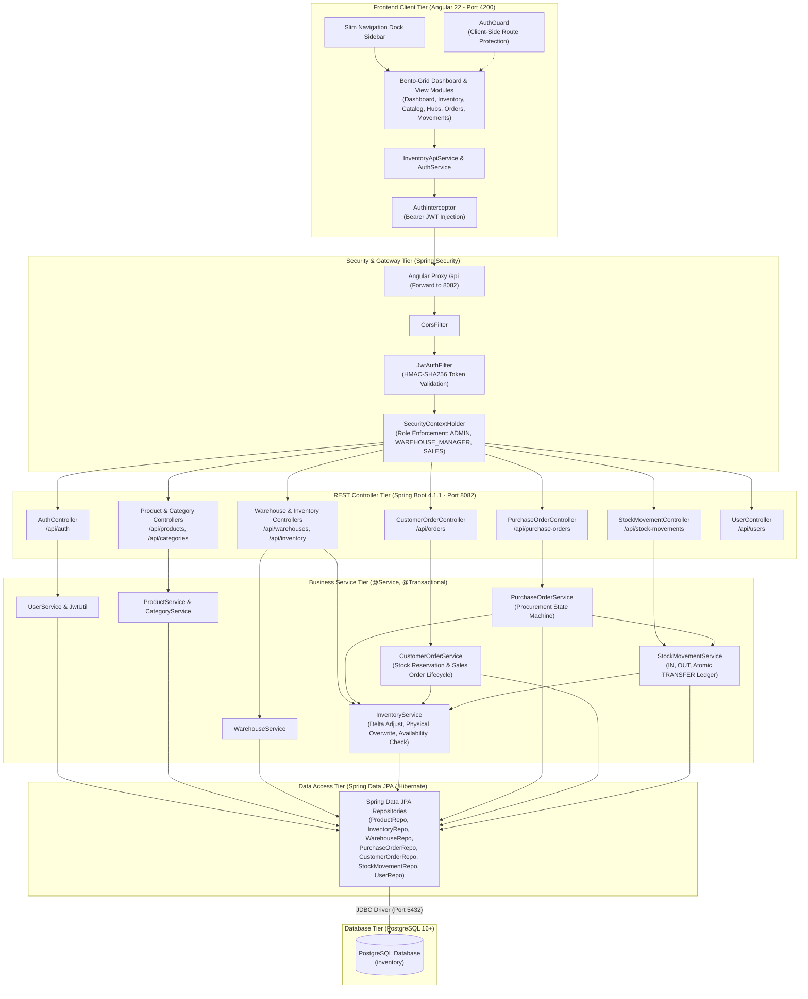
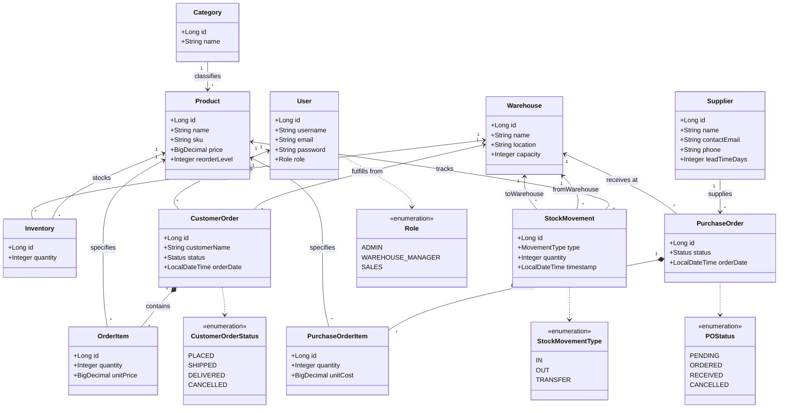
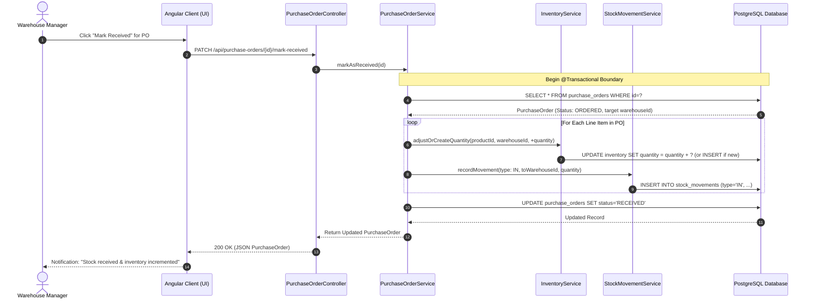
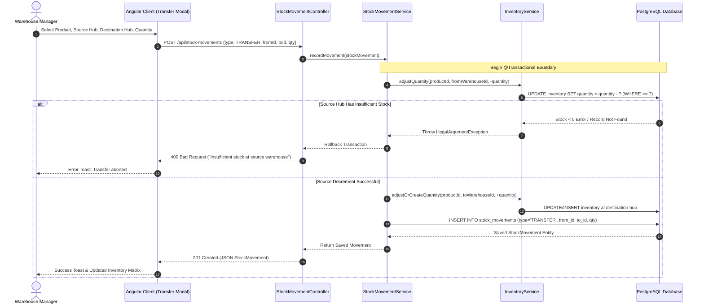
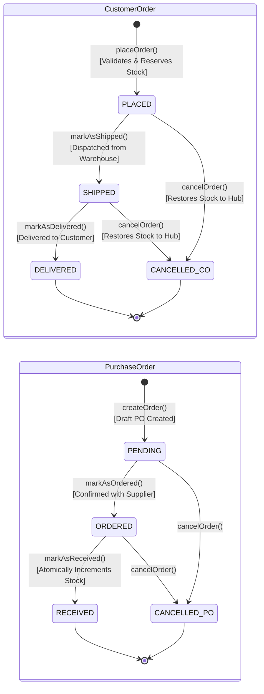

# Retail Inventory Management System (RIMS)

[](https://openjdk.org/)
[](https://spring.io/projects/spring-boot)
[](https://angular.dev/)
[](https://www.typescriptlang.org/)
[](https://www.postgresql.org/)
[](https://spring.io/projects/spring-security)
[](#)

An enterprise-grade, distributed **Retail Inventory Management System (RIMS)** built with a **Spring Boot 4 (Java 27)** REST API backend and an **Angular 22** client frontend. The platform provides real-time multi-warehouse stock auditing, supplier procurement lifecycles, atomic customer order fulfillment with upfront stock reservation, inter-hub logistics transfers, and stateless JWT role-based security (`ADMIN`, `WAREHOUSE_MANAGER`, `SALES`).

The frontend features a **Deep Forest Green** color palette and a modern **10-Card Bento-Grid** executive command dashboard with glowing telemetry rings, neon sparkline curves, and a minimalist icon dock sidebar.

---

## Table of Contents

- [Visual Design & Palette](#visual-design--palette)
- [Key Features](#key-features)
- [System Architecture (UML Component Diagram)](#system-architecture)
- [Repository Structure](#repository-structure)
- [Domain & Data Models (UML Class Diagram)](#domain--data-models)
- [Business Workflows & UML Diagrams](#business-workflows--uml-diagrams)
  - [1. Customer Sales Order & Stock Reservation (Sequence)](#1-customer-sales-order--stock-reservation-sequence)
  - [2. Supplier Procurement & Goods Receipt (Sequence)](#2-supplier-procurement--goods-receipt-sequence)
  - [3. Inter-Warehouse Stock Transfer (Sequence)](#3-inter-warehouse-stock-transfer-sequence)
  - [4. Order Lifecycle State Machines (Statechart)](#4-order-lifecycle-state-machines-statechart)
  - [5. Authentication & JWT Authorization Flow (Sequence)](#5-authentication--jwt-authorization-flow-sequence)
- [Security & Authentication](#security--authentication)
- [REST API Reference](#rest-api-reference)
- [Prerequisites & Setup](#prerequisites--setup)
- [Running the Full-Stack Application](#running-the-full-stack-application)
- [Frontend Components & Modules](#frontend-components--modules)

---

## Visual Design & Palette

The user interface follows a bespoke **Deep Forest Green Bento-Grid** design system implemented in [`frontend/src/styles.css`](file:///c:/Users/acer/Desktop/HCLTech-RIMS/frontend/src/styles.css):

### Color Palette

| Swatch | Hex Code | Purpose in Application |
|---|---|---|
| **Deep Forest Black** | `#051F20` | Canvas backdrop with subtle ambient teal/orange radial illumination |
| **Dark Spruce Green** | `#0B2B26` | Slim icon dock sidebar, card header banners, table headers |
| **Mid Forest Green** | `#163832` | Bento card surfaces, modal dialogs, and interactive surfaces |
| **Forest Accent** | `#235347` | Component borders, button backgrounds, and active state indicators |
| **Mint / Sage Green** | `#8EB69B` | Secondary metrics, labels, glowing curve traces, and brand icons |
| **Pale Mint / Cream** | `#DAF1DE` | Primary display titles, large numeric readouts, and high-contrast text |

### Executive Bento Dashboard Features

- **Slim Icon Dock Sidebar:** Minimalist 76px vertical navigation rail with an illuminated top brand pill, tooltip navigation, light/dark theme switcher, and operator identity pill.
- **Operator Greeting & Live Sparkline:** Personalized operator greeting, live digital clock, and glowing neon cyan/mint wave sparkline.
- **Facility Climate & Conditions:** Real-time facility climate gauge (21°C, humidity, and operational status).
- **Order Fulfillment Ring Gauge:** Circular SVG gauge tracking daily dispatch velocity and percentage.
- **Reorder Sweep Countdown Timer:** Interactive countdown sweep ring with warm amber glow and Start/Pause controls.
- **Operations Priority Checklist:** Interactive checklist with completed, in-progress, and pending status tags.
- **Network Pulse Sine Wave:** Vibrant multi-color wave showing network throughput and sub-15ms fleet latency.
- **Weekly Dispatch Bar Chart:** 7-day capsule bar chart with active Saturday dispatch peak (`148 units`).
- **Quick Action Hub:** One-click shortcuts for PO creation, Sales Orders, Stock Transfers, Audits, Catalog, and Warehouses.
- **Inbound Deliveries Schedule:** Calendar schedule of arriving supplier freight.
- **Facility Storage Status:** Overall facility capacity ring and individual warehouse fill rate progress bars.

---

## Key Features

- **Multi-Warehouse Stock Management**: Real-time stock tracking across geographically dispersed facilities with capacity limits, reorder thresholds, and instant delta adjustments.
- **Supplier Procurement (Purchase Orders)**: Complete procurement lifecycle (`PENDING` $\rightarrow$ `ORDERED` $\rightarrow$ `RECEIVED`) where receiving shipments **atomically increments inventory** in the destination hub.
- **Customer Sales Fulfillment**: Order placement with strict upfront stock availability checks, automated stock reservation, order lifecycles (`PLACED` $\rightarrow$ `SHIPPED` $\rightarrow$ `DELIVERED`), and automated stock restoration on cancellation.
- **Stock Movement Auditing**: Complete immutable audit trail for inventory operations:
  - `IN`: Supplier deliveries and new stock arrivals.
  - `OUT`: Dispatches and shrinkage adjustments.
  - `TRANSFER`: Atomic inter-warehouse transfers (simultaneous source decrement and destination increment).
- **Stateless Role-Based JWT Security**: Secured endpoints with HMAC SHA-256 tokens, BCrypt password hashing, write-only password serialization, and granular role authorization (`ADMIN`, `WAREHOUSE_MANAGER`, `SALES`).

---

## System Architecture

The system implements a decoupled, modern multi-tier architecture with an **Angular 22** client communicating over REST/JSON with a **Spring Boot 4.1.1** backend, backed by **PostgreSQL**:



---

## Repository Structure

```text
HCLTech-RIMS/
├── backend/                       # Spring Boot REST API Service (Port 8082)
│   ├── .mvn/                      # Maven Wrapper configuration
│   ├── src/
│   │   ├── main/
│   │   │   ├── java/com/hcl/inventory/
│   │   │   │   ├── config/        # SecurityConfig (JWT + CORS), PasswordConfig
│   │   │   │   ├── controller/    # 10 REST Controllers
│   │   │   │   ├── dto/           # Request/Response DTO payloads
│   │   │   │   ├── exception/     # GlobalExceptionHandler (@RestControllerAdvice)
│   │   │   │   ├── model/         # 11 JPA Domain Entities
│   │   │   │   ├── repository/    # 9 Spring Data JPA Repositories
│   │   │   │   ├── security/      # JwtAuthFilter & JwtUtil
│   │   │   │   ├── service/       # Business workflows & lifecycle logic
│   │   │   │   └── InventoryApplication.java
│   │   │   └── resources/
│   │   │       ├── application.yaml        # Port 8082 & DB configuration
│   │   │       └── application-local.yaml  # Local development overrides
│   │   └── test/                  # Test suites & isolated H2 profile
│   ├── mvnw / mvnw.cmd            # Maven wrapper executables
│   └── pom.xml                    # Maven POM (Java 27, Spring Boot 4.1.1, Lombok 1.18.48)
├── frontend/                      # Angular 22 Single Page Application (Port 4200)
│   ├── src/
│   │   ├── app/
│   │   │   ├── components/        # Bento Dashboard, Inventory, Catalog, Hubs, Orders
│   │   │   │   ├── dashboard/     # 10-card Bento dashboard with SVG charts
│   │   │   │   ├── inventory/     # Stock matrix, delta adjust & audit modals
│   │   │   │   ├── products/      # Catalog management & category taxonomy
│   │   │   │   ├── warehouses/    # Hub cards, capacity meters & manifests
│   │   │   │   ├── purchase-orders/ # PO builder & receiving workflows
│   │   │   │   ├── customer-orders/ # Sales orders with real-time stock checks
│   │   │   │   ├── stock-movements/ # Immutable movement ledger & transfers
│   │   │   │   ├── suppliers/     # Vendor directory & lead time tracking
│   │   │   │   ├── users/         # Operator directory & role permissions
│   │   │   │   ├── login/         # Forest green authentication terminal
│   │   │   │   ├── shell/         # Slim icon dock sidebar layout
│   │   │   │   └── toast/         # Animated notification system
│   │   │   ├── guards/            # authGuard (route protection)
│   │   │   ├── interceptors/      # authInterceptor (JWT token injection)
│   │   │   ├── models/            # TypeScript interfaces matching backend models
│   │   │   ├── services/          # AuthService, InventoryApiService, ToastService
│   │   │   ├── app.config.ts      # App configuration with HttpClient & Interceptor
│   │   │   ├── app.routes.ts      # Angular routing definitions
│   │   │   └── app.ts             # Root application component
│   │   ├── index.html             # Fonts, Remixicon icons, and viewport
│   │   └── styles.css             # Forest green Bento-grid design system
│   ├── angular.json               # Angular CLI configuration with proxy setup
│   ├── package.json               # Node dependencies (Angular 22, RxJS, Vite)
│   └── proxy.conf.json            # Reverse proxy forwarding /api to port 8082
├── docs/                          # Architecture & design specifications
│   ├── DESIGN.md                  # Comprehensive visual design system authority
│   ├── PROJECT_CRUX.md            # Crux & system architecture specification
│   └── TEST_REPORT.md             # System test audit & defect matrix
└── README.md                      # Project documentation and quickstart
```

---

## Domain & Data Models

### UML Class Diagram

The following UML class diagram models all 11 JPA domain entities, their primary attributes, associations, and operational enumerations:



### Entity Schema Summary

| Entity | Table | Key Fields | Description |
| :--- | :--- | :--- | :--- |
| **`User`** | `users` | `id`, `username`, `email`, `password`, `role` | Operator accounts (`ADMIN`, `WAREHOUSE_MANAGER`, `SALES`). Passwords are write-only. |
| **`Category`** | `categories` | `id`, `name` | Product taxonomy and grouping. |
| **`Product`** | `product` | `id`, `name`, `sku`, `price`, `reorderLevel`, `category_id` | Catalog item with unique SKU and reorder thresholds. |
| **`Warehouse`** | `warehouses` | `id`, `name`, `location`, `capacity` | Physical storage facilities. |
| **`Inventory`** | `inventory` | `id`, `product_id`, `warehouse_id`, `quantity` | Stock counts per product-warehouse pair (`UNIQUE [product_id, warehouse_id]`). |
| **`Supplier`** | `suppliers` | `id`, `name`, `contactEmail`, `phone`, `leadTimeDays` | Approved procurement vendors with delivery lead times. |
| **`PurchaseOrder`** | `purchase_orders` | `id`, `supplier_id`, `warehouse_id`, `status`, `orderDate` | Inbound orders (`PENDING`, `ORDERED`, `RECEIVED`, `CANCELLED`). |
| **`PurchaseOrderItem`**| `purchase_order_items` | `id`, `purchase_order_id`, `product_id`, `quantity`, `unitCost` | Line items with unit costs and quantities. |
| **`CustomerOrder`** | `customer_orders` | `id`, `customerName`, `warehouse_id`, `user_id`, `status`, `orderDate` | Outbound sales orders (`PLACED`, `SHIPPED`, `DELIVERED`, `CANCELLED`). |
| **`OrderItem`** | `order_items` | `id`, `customer_order_id`, `product_id`, `quantity`, `unitPrice` | Line items for customer orders. |
| **`StockMovement`** | `stock_movements` | `id`, `product_id`, `from_warehouse_id`, `to_warehouse_id`, `quantity`, `type`, `timestamp` | Audit log for `IN`, `OUT`, and `TRANSFER` operations. |

---

## Business Workflows & UML Diagrams

### 1. Customer Sales Order & Stock Reservation (Sequence)

Customer order placement enforces **strict upfront stock validation** across all line items before decrementing stock. If any single product has insufficient quantity in the target warehouse, the transaction is rejected immediately with zero changes applied to the database:


### 2. Supplier Procurement & Goods Receipt (Sequence)

Inbound procurement flows from initial creation to vendor confirmation and goods receipt. When goods arrive at the destination warehouse, the manager marks the PO as `RECEIVED`, which **atomically increments inventory** and writes an immutable audit record:



### 3. Inter-Warehouse Stock Transfer (Sequence)

Inter-hub logistics movements transfer inventory between facilities. The system atomically decrements the source facility (ensuring stock is available) and increments the destination facility, recording a single `TRANSFER` audit entry:



### 4. Order Lifecycle State Machines (Statechart)

The lifecycles of Customer Orders and Purchase Orders are governed by strict finite state machines:



### 5. Authentication & JWT Authorization Flow (Sequence)

Authentication is completely stateless. Clients authenticate against `/api/auth/login` to obtain an HMAC SHA-256 token, which is stored locally and attached to subsequent requests:

```mermaid
sequenceDiagram
    autonumber
    actor User as Operator
    participant Client as Angular Client (Login Terminal)
    participant AuthFilter as JwtAuthFilter
    participant AuthCtrl as AuthController
    participant AuthMgr as AuthenticationManager
    participant JwtUtil as JwtUtil
    participant ProtectedCtrl as Protected Controllers (/api/**)

    rect rgb(22, 56, 50)
    Note over User,JwtUtil: 1. Authentication Phase
    User->>Client: Submit Credentials (username, password)
    Client->>AuthCtrl: POST /api/auth/login {username, password}
    AuthCtrl->>AuthMgr: authenticate(UsernamePasswordAuthenticationToken)
    AuthMgr->>AuthMgr: Verify password using BCrypt
    AuthCtrl->>JwtUtil: generateToken(username, roles)
    JwtUtil-->>AuthCtrl: Signed JWT Token (HMAC SHA-256, 24h validity)
    AuthCtrl-->>Client: 200 OK {token, role, username}
    Client->>Client: Store token in localStorage
    end

    rect rgb(11, 43, 38)
    Note over User,ProtectedCtrl: 2. Authenticated Request Phase
    User->>Client: Navigate to Inventory Matrix / Warehouses
    Client->>AuthFilter: HTTP GET /api/inventory [Authorization: Bearer <token>]
    AuthFilter->>JwtUtil: validateToken(token) & extractUsername()
    JwtUtil-->>AuthFilter: Valid Claims (Subject: user, Role: WAREHOUSE_MANAGER)
    AuthFilter->>AuthFilter: Set SecurityContextHolder(Authentication)
    AuthFilter->>ProtectedCtrl: Forward to InventoryController
    ProtectedCtrl-->>Client: 200 OK [Inventory Payload]
    Client-->>User: Render Stock Matrix View
    end
```



---

## Security & Authentication

Authentication is handled via stateless **JSON Web Tokens (JWT)**:

- **Tokens**: HMAC SHA-256 tokens (`jjwt-api 0.12.6`) with a 24-hour expiration window.
- **Authorization Header**: Client requests include `Authorization: Bearer <token>`.
- **Public Routes**:
  - `POST /api/auth/login` — Returns token and role.
  - `POST /api/users/register` — Registers a new user account with BCrypt password hashing.
- **Admin Only**:
  - All `DELETE /api/**` endpoints are strictly restricted to `ROLE_ADMIN`.
- **Granular Role Permissions**:
  - `ADMIN`: Unrestricted system privileges.
  - `WAREHOUSE_MANAGER`: Inventory management, stock movements, and purchase orders.
  - `SALES`: Customer sales order creation and fulfillment tracking.
- **Quick Demo Profiles**:
  - **Admin**: `admin` / `admin123` (or `password`)
  - **Manager**: `manager` / `password`
  - **Sales**: `sales` / `password`

---

## REST API Reference

All backend endpoints are rooted at `/api`:

### 🔐 Authentication & Users
| Method | Endpoint | Access | Summary |
| :--- | :--- | :--- | :--- |
| `POST` | `/api/auth/login` | Public | Authenticate user credentials and receive JWT |
| `POST` | `/api/users/register` | Public | Register a new user |
| `GET` | `/api/users` | Authenticated | List all registered operators |
| `GET` | `/api/users/{id}` | Authenticated | Get user profile by ID |
| `PUT` | `/api/users/{id}` | Authenticated | Update user profile and role |
| `DELETE`| `/api/users/{id}` | **Admin** | Revoke and remove user account |

### 📦 Products & Categories
| Method | Endpoint | Access | Summary |
| :--- | :--- | :--- | :--- |
| `GET` | `/api/categories` | Authenticated | List all categories |
| `POST` | `/api/categories` | Authenticated | Create a new category |
| `PUT` | `/api/categories/{id}` | Authenticated | Update category name |
| `DELETE`| `/api/categories/{id}` | **Admin** | Delete category |
| `GET` | `/api/products` | Authenticated | List all products in catalog |
| `GET` | `/api/products/{id}` | Authenticated | Get single product by ID |
| `POST` | `/api/products` | Authenticated | Create product with SKU, price, and category |
| `PUT` | `/api/products/{id}` | Authenticated | Update product information |
| `DELETE`| `/api/products/{id}` | **Admin** | Delete product |

### 🏢 Warehouses & Inventory
| Method | Endpoint | Access | Summary |
| :--- | :--- | :--- | :--- |
| `GET` | `/api/warehouses` | Authenticated | List all warehouse locations |
| `POST` | `/api/warehouses` | Authenticated | Provision a new warehouse facility |
| `PUT` | `/api/warehouses/{id}` | Authenticated | Update warehouse facility details |
| `DELETE`| `/api/warehouses/{id}` | **Admin** | Delete warehouse |
| `GET` | `/api/inventory` | Authenticated | View all warehouse stock rows |
| `GET` | `/api/inventory/warehouse/{warehouseId}` | Authenticated | Filter inventory by warehouse |
| `GET` | `/api/inventory/product/{productId}` | Authenticated | Filter inventory by product |
| `POST` | `/api/inventory` | Authenticated | Initialize stock for a product-warehouse pair |
| `PUT` | `/api/inventory/{id}` | Authenticated | Exact physical stock audit count overwrite |
| `PATCH`| `/api/inventory/adjust?productId={p}&warehouseId={w}` | Authenticated | Delta stock adjustment (`{"delta": 10}`) |
| `DELETE`| `/api/inventory/{id}` | **Admin** | Remove inventory record |

### 🚚 Suppliers & Purchase Orders
| Method | Endpoint | Access | Summary |
| :--- | :--- | :--- | :--- |
| `GET` | `/api/suppliers` | Authenticated | List registered suppliers |
| `POST` | `/api/suppliers` | Authenticated | Register new vendor |
| `GET` | `/api/purchase-orders` | Authenticated | List purchase orders |
| `POST` | `/api/purchase-orders` | Authenticated | Issue PO with dynamic line items |
| `PATCH`| `/api/purchase-orders/{id}/mark-ordered` | Authenticated | Transition status: `PENDING` $\rightarrow$ `ORDERED` |
| `PATCH`| `/api/purchase-orders/{id}/mark-received` | Authenticated | Receive PO and automatically increment stock |
| `PATCH`| `/api/purchase-orders/{id}/cancel` | Authenticated | Cancel pending purchase order |

### 🛒 Customer Sales Orders
| Method | Endpoint | Access | Summary |
| :--- | :--- | :--- | :--- |
| `GET` | `/api/orders` | Authenticated | List all customer sales orders |
| `GET` | `/api/orders/warehouse/{warehouseId}` | Authenticated | View orders fulfilled by a warehouse |
| `POST` | `/api/orders` | Authenticated | Place order (validates & reserves stock) |
| `PATCH`| `/api/orders/{id}/mark-shipped` | Authenticated | Transition status: `PLACED` $\rightarrow$ `SHIPPED` |
| `PATCH`| `/api/orders/{id}/mark-delivered` | Authenticated | Transition status: `SHIPPED` $\rightarrow$ `DELIVERED` |
| `PATCH`| `/api/orders/{id}/cancel` | Authenticated | Cancel order and automatically restore stock |

### 🔄 Stock Movements & Transfers
| Method | Endpoint | Access | Summary |
| :--- | :--- | :--- | :--- |
| `GET` | `/api/stock-movements` | Authenticated | List all stock movement audit logs |
| `GET` | `/api/stock-movements/product/{productId}` | Authenticated | Movement logs for a specific product |
| `POST` | `/api/stock-movements` | Authenticated | Execute an `IN`, `OUT`, or `TRANSFER` movement |

---

## Prerequisites & Setup

### Requirements
- **Java**: OpenJDK 27 (or 21+)
- **Node.js**: v20+ or v24+ with `npm`
- **Database**: PostgreSQL 16+ running locally on port `5432`
- **Build Tools**: Maven Wrapper (included) & Angular CLI

### 1. Database Setup
Create the PostgreSQL database:

```sql
CREATE DATABASE inventory;
```

*(Or via terminal: `createdb -U postgres inventory`)*

### 2. Configure Credentials
Review [`backend/src/main/resources/application.yaml`](file:///c:/Users/acer/Desktop/HCLTech-RIMS/backend/src/main/resources/application.yaml) and [`application-local.yaml`](file:///c:/Users/acer/Desktop/HCLTech-RIMS/backend/src/main/resources/application-local.yaml) for PostgreSQL connection settings:

```yaml
server:
  port: ${PORT:8082}

spring:
  datasource:
    url: jdbc:postgresql://localhost:5432/inventory
    username: postgres
    password: your_password
```

---

## Running the Full-Stack Application

### 1. Start the Backend API (Port 8082)
From the repository root, open a terminal:

```powershell
cd backend
.\mvnw.cmd spring-boot:run
```

The Spring Boot REST API will start at **`http://localhost:8082`**.

### 2. Start the Frontend Client (Port 4200)
Open a second terminal:

```powershell
cd frontend
npm start
```

The Angular client will start at **`http://localhost:4200`** with proxy routing configured in `proxy.conf.json` to automatically forward all `/api` calls to port `8082`.

---

## Frontend Components & Modules

| Module / Component | Route | Description |
|---|---|---|
| **[Login Terminal](file:///c:/Users/acer/Desktop/HCLTech-RIMS/frontend/src/app/components/login/login.component.ts)** | `/login` | Forest green authentication console with quick-access demo profiles (`ADMIN`, `MANAGER`, `SALES`) and registration. |
| **[Command Center Dashboard](file:///c:/Users/acer/Desktop/HCLTech-RIMS/frontend/src/app/components/dashboard/dashboard.component.ts)** | `/dashboard` | 10-card Bento Grid featuring greeting sparklines, climate gauge, fulfillment rings, reorder timer, and dispatch bar charts. |
| **[Inventory Matrix](file:///c:/Users/acer/Desktop/HCLTech-RIMS/frontend/src/app/components/inventory/inventory.component.ts)** | `/inventory` | Searchable stock matrix with warehouse/category filters, delta adjustment modal, audit override modal, and new stock binding. |
| **[Product Catalog](file:///c:/Users/acer/Desktop/HCLTech-RIMS/frontend/src/app/components/products/products.component.ts)** | `/products` | Catalog manager with SKU validation, pricing, reorder thresholds, and category taxonomy drawer. |
| **[Warehouses & Hubs](file:///c:/Users/acer/Desktop/HCLTech-RIMS/frontend/src/app/components/warehouses/warehouses.component.ts)** | `/warehouses` | Facility telemetry cards, fill percentage gauges, facility provisioning, and stored item manifests. |
| **[Purchase Orders](file:///c:/Users/acer/Desktop/HCLTech-RIMS/frontend/src/app/components/purchase-orders/purchase-orders.component.ts)** | `/purchase-orders` | Dynamic PO line-item builder with auto-totals, dispatch actions, and shipment receiving that increments stock. |
| **[Customer Sales Orders](file:///c:/Users/acer/Desktop/HCLTech-RIMS/frontend/src/app/components/customer-orders/customer-orders.component.ts)** | `/customer-orders` | Order creation with real-time warehouse stock checks, atomic reservation, and automatic stock restoration upon cancellation. |
| **[Stock Movements](file:///c:/Users/acer/Desktop/HCLTech-RIMS/frontend/src/app/components/stock-movements/stock-movements.component.ts)** | `/stock-movements` | Immutable audit trail and modal for executing inter-warehouse stock transfers. |
| **[Suppliers Directory](file:///c:/Users/acer/Desktop/HCLTech-RIMS/frontend/src/app/components/suppliers/suppliers.component.ts)** | `/suppliers` | Procurement vendor registry tracking contact emails, phones, and average delivery lead times. |
| **[Operator Registry](file:///c:/Users/acer/Desktop/HCLTech-RIMS/frontend/src/app/components/users/users.component.ts)** | `/users` | Admin-only identity provisioning and role assignments (`ADMIN`, `WAREHOUSE_MANAGER`, `SALES`). |
